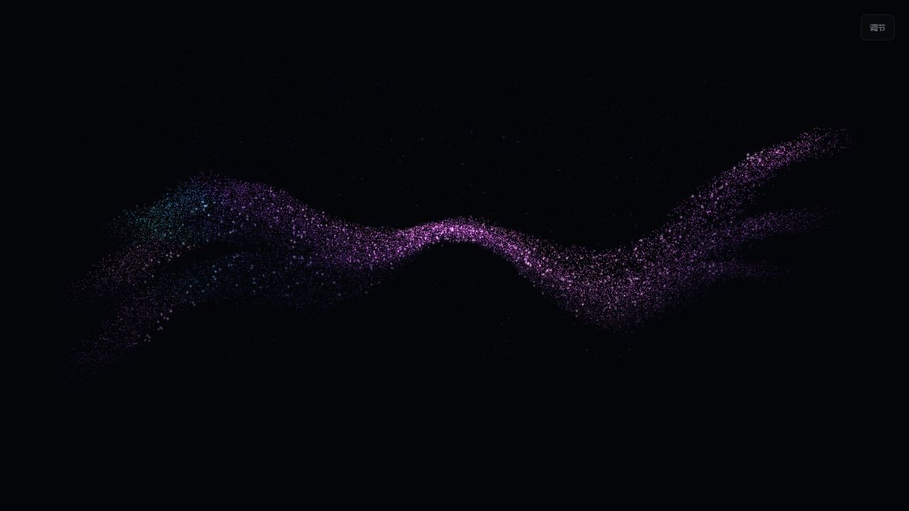

# Chromatic Flow · V0.3

音乐驱动的流光粒子壁纸。**[在线预览](https://zllyyy-ultra.github.io/chromatic-flow/)** · [V0.3 验收](docs/V0.3.md)



## 从固定曲面变成自由粒子

- 三种体积形态：流光丝带、三臂旋涡、漂浮星云。自动漫游会连续交融，也可手动固定其中一种。
- 四套流动配色：极光、落日、深海、绯梦。自动变幻会缓慢过渡；手动配色内部仍有流动色彩。
- 三种粒子外观：柔光微尘、闪烁星芒、空灵光环。
- 音乐明显推动聚散、波动、星芒、色流与漫游速度；采用平滑包络，停止音乐后自然回落。
- 默认中密度 35,040 粒子、65% 音乐响应。更多调节可改变流速、亮度、密度，另外提供空间舒展与色彩流速。

## 本地使用

直接离线打开 index.html；也可使用 Node.js 22+：

```sh
npm start
npm test
npm run build
```

本地预览 http://127.0.0.1:4173 。点击模拟音乐预览；它只生成频谱，不播放或录制声音。H 收起面板，F 全屏，空格暂停。没有音频时仍有舒缓流动。

## Wallpaper Engine

下载并解压 Actions 的 chromatic-flow-wallpaper 附件，或运行构建后使用 wallpaper/ 文件夹。将 index.html 和全部关联资源导入 Web 壁纸编辑器。完整资源包括 index.html、style.css、audio.js、evolution.js、app.js、project.json、preview.png。也可将文件夹放入 wallpaper_engine/projects/myprojects/。

若编辑器重新生成 project.json，保留 general.properties 和 general.supportsaudioprocessing: true，保存并重新加载。宿主下网页面板自动隐藏，使用 Wallpaper Engine 属性面板调节形态、配色、外观、响应与流速。播放系统音乐验证响应。

本轮验证宿主接口模拟和浏览器渲染；没有运行真实 Wallpaper Engine，未认证系统音频采集与各显卡长期性能。

## 部署与复验

main 推送自动运行 7 项音频/过渡测试、构建、上传导入包并部署 GitHub Pages。Pages Source 应为 GitHub Actions。dist/ 只包含离线资源。

npm start 后打开 /tests/visual.html，可执行真实 WebGL 初始化、三种形态/粒子外观、自动颜色变化、属性限幅、音频与断流、暂停、密度与图形上下文恢复测试。页面末尾显示 ALL CHECKS PASSED 时通过。该测试页不包含在 Pages 和壁纸包中。

## 技术与隐私

WebGL 1 / GLSL ES 1.00；静态 UV 缓冲、单次绘制、DPR 上限 1.5、约 360 万像素预算。确定性散点取代规则网格；CPU 仅计算少量形态权重和调色板，GPU 计算粒子运动。页面隐藏/宿主暂停时停止绘制，支持上下文恢复。

无 CDN、无运行依赖、无录音、上传或遥测。接口依据：[音频](https://docs.wallpaperengine.io/en/web/audio/visualizer.html)、[宿主属性](https://docs.wallpaperengine.io/en/web/api/propertylistener.html)。V0.2 记录保留在 docs/VALIDATION.md。
